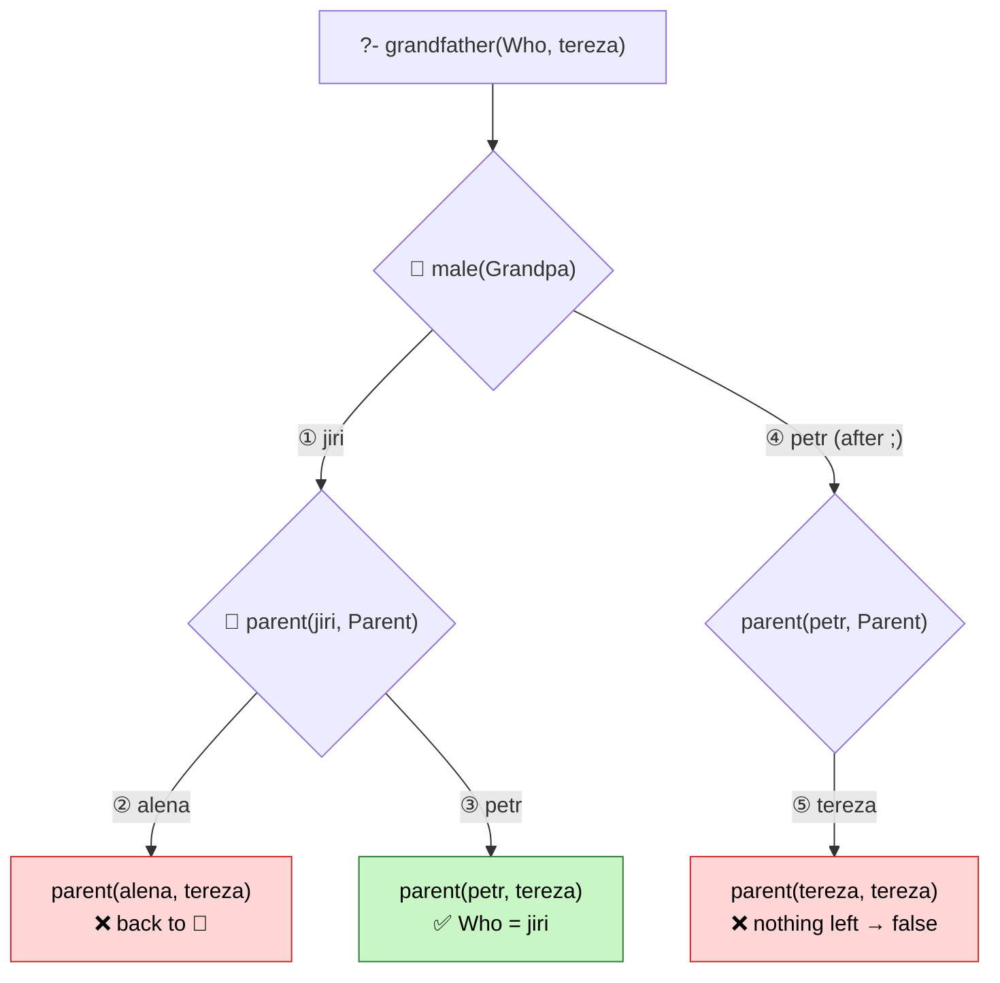

# Prolog for Beginners 🚀

Welcome to this repository! This is a collection of simple Prolog programs designed for beginners who are just starting to learn Logic Programming. 

Here, you will find basic examples covering fundamental concepts like **facts, rules, variables, and queries**.

---

## 🛠️ Installation

To run these programs, you need to have **SWI-Prolog** installed on your system. 

### Windows (using Chocolatey)
If you use Windows and have the [Chocolatey](https://chocolatey.org) package manager installed, you can install SWI-Prolog quickly via administrative PowerShell or Command Prompt:

```bash
choco install swi-prolog
```

*For other operating systems, you can download the installer directly from the [SWI-Prolog website](https://swi-prolog.org).*

---

## 📋 What's Inside?

A typical beginner example in this repository (like the family relations script) demonstrates the core pillars of Prolog:

1. **Facts:** Defining basic truths (e.g., `male(jiri).`, `parent(jiri, alena).`).
2. **Rules:** Defining logical relationships using variables and conditions (e.g., finding a `grandfather`).
3. **Queries:** Asking Prolog questions to check facts or find unknown values using variables.

---

## 🧩 Prolog in One Picture

> Examples come from [`relations/relations.pl`](relations/relations.pl).

```
 FACT       parent( jiri , alena ).        "jiri is a parent of alena"
            ──┬───  ─────┬──────  ┬
            name    2 arguments   └─ every clause ends with "."
                         │
                         └──► ARITY = 2  ──►  predicate  parent/2

 RULE       grandfather(Grandpa, Child) :-     ◄── HEAD (what we conclude)
                male(Grandpa),                 ┐
                parent(Grandpa, Parent),       ├─ BODY (what must hold)
                parent(Parent, Child).         ┘
                                     ":-" = IF     "," = AND     ";" = OR

 QUERY   ?- grandfather( Who , tereza ).
         ─┬─             ─┬─   ──┬───
         ask         Variable   atom
                   (Uppercase)  (lowercase = constant)

 ANSWER     Who = jiri.
```

| Term | In one line |
|---|---|
| **Atom** | a constant, lowercase: `jiri`, `tereza` |
| **Variable** | an unknown, Uppercase or `_`: `Who`, `Child` |
| **Fact** | `head.`, always true |
| **Rule** | `head :- body.`, true if the body holds |
| **Clause** | a single fact or rule |
| **Predicate** | all clauses with the same name and arity, e.g. `parent/2` |
| **Arity** | the number of arguments; `parent/2` ≠ `parent/3` |

### Unification: "can these two be made equal?"

```
 parent(jiri, X )   ⟷   parent(jiri, alena)    ✅  X = alena
 parent(jiri, X )   ⟷   parent(jana, alena)    ❌  jiri ≠ jana
 parent( X  , X )   ⟷   parent(jiri, alena)    ❌  X can't be both
```

### Operators: the essentials

| Operator | Meaning | Example |
|---|---|---|
| `:-` | **IF** (rule) | `a :- b.` |
| `,` `;` | **AND**, **OR** | `male(X), parent(X, Y)` |
| `\+` | **NOT** (cannot be proven) | `\+ male(jana)` |
| `->` | if-then(-else) | `(X > 0 -> S = pos ; S = neg)` |
| `!` | **cut**: stop backtracking here | `max(X, Y, X) :- X >= Y, !.` |
| `=` `\=` | unify / cannot unify | `X = jiri` |
| `==` `\==` | identical / not identical (no binding) | `a == a` |
| `is` | **compute** arithmetic | `X is 2 + 3` → `5` |
| `=:=` `=\=` | numbers equal / not equal | `1 + 2 =:= 3` |
| `<` `>` `=<` `>=` | compare numbers (**`=<`, not `<=`**) | `3 =< 5` |
| `+` `-` `*` `/` `//` `mod` `**` | arithmetic (`//` integer division) | `X is 7 // 2` → `3` |

> ⚠️ `X = 2 + 3` → `X = 2+3` (just a structure) &nbsp;·&nbsp; `X is 2 + 3` → `X = 5` (computed)

---

## 🔙 Backtracking

**Goals left → right, facts top → bottom. If a goal fails, go back to the last 📍 choice point and try the next option.**



```prolog
?- grandfather(Who, tereza).
Who = jiri ;      % ";" = "look for another answer" → forces backtracking
false.            % no other answer exists
```

---

## 💻 How to Run the Programs

### 1. Start SWI-Prolog
Open your terminal, command prompt, or PowerShell and launch the Prolog shell:
```bash
swipl
```

### 2. Load a File
Load your chosen Prolog file (for example, `relations.pl`) into the interpreter:
```prolog
?- [relations].
```
*(Note: Do not include the `.pl` extension inside the brackets, and don't forget the period `.` at the end!)*

### 3. Query the Database
Once the file is loaded, you can run different types of queries:

*   **Yes/No Query** (Checking if a statement is true):
    ```prolog
    ?- grandfather(jiri, tereza).
    % Output: true.
    ```

*   **Variable Query** (Asking Prolog to find a value):
    ```prolog
    ?- grandfather(Who, tereza).
    % Output: Who = jiri.
    ```

*   **Multiple Answers** (If a query has more than one solution, press the semicolon `;` key to see the next result):
    ```prolog
    ?- parent(jiri, Child).
    % Output: 
    % Child = alena ;
    % Child = petr.
    ```

### 4. Exit
To close the SWI-Prolog interpreter, type:
```prolog
?- halt.
```

---

Happy coding! 🧠
